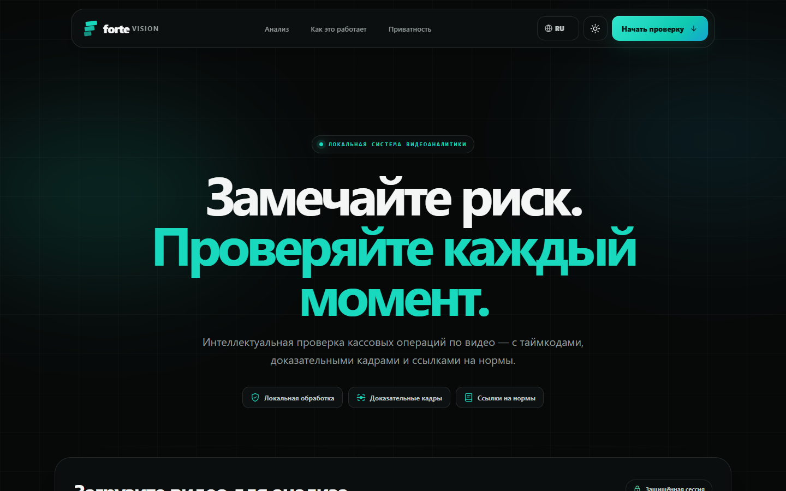
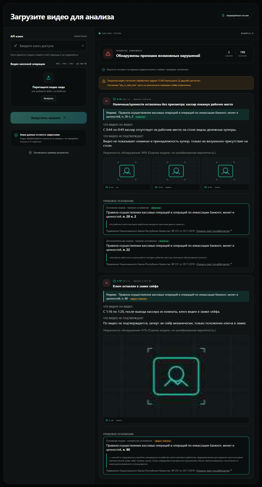
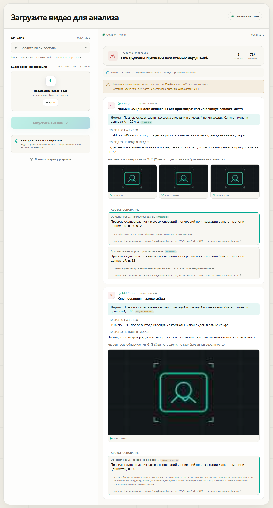
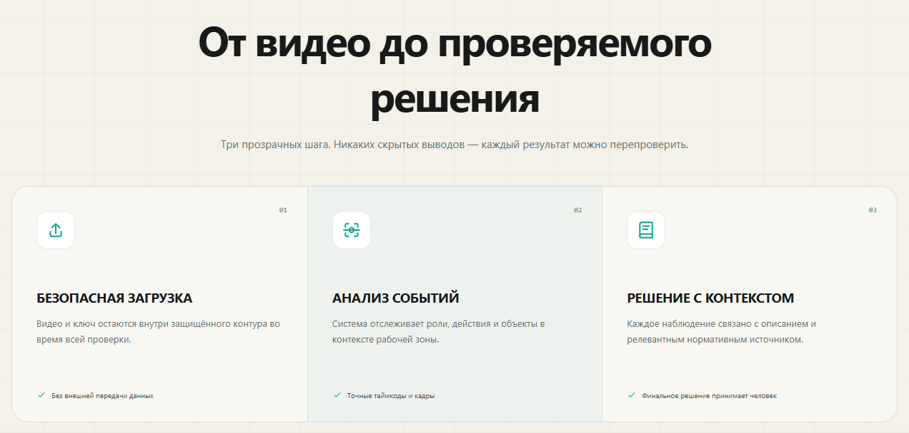
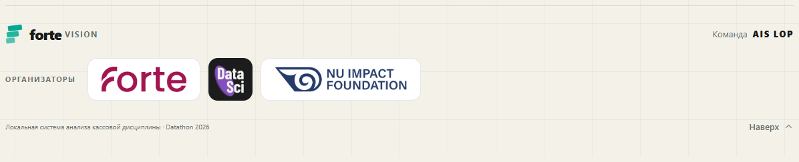
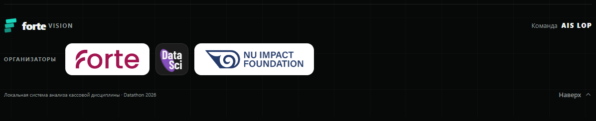

# Forte cash-discipline video checker

A fully local AI service for Datathon 26 (ForteBank). Upload a short video of a cashier's desk
(`.mov`, `.mp4` or `.mkv`, up to 180 s) and get back a verdict:

- **«Нарушение не обнаружено»** - no violation found, or
- **«Обнаружены признаки возможных нарушений»** - signs of possible violations.

For each finding the service gives the violation type, a timecode, 1-3 evidence frames cut from
the original video with the triggering object boxed, a plain-language description of what is
visible, and the norm of Kazakhstan law it rests on.

No cloud AI is used anywhere in the processing path (task.md §7). Perception, rules, evidence
extraction and serving all run on the team's own GPU host from pre-downloaded, pinned weights.

## Live Demo



Latest recorded public deployment: [Open Web UI](https://forte-checker-wwi4jcrss.gobrev.dev/)
(A28 on `datathon` -- A21's F1 ruleset with the optional Qwen3-VL-4B safe-check add-on left off --
last recorded 2026-10-18; see [deployment notes](deploy/README.md)).
The corresponding API base is `https://forte-checker-wwi4jcrss.gobrev.dev/api/v1`.
The jury received its API key out of band; it is not stored in this repository.

Enter the key and choose a video to submit. The key stays in page memory and must be entered
again after reload. **«Посмотреть пример результата»** displays the result layout with synthetic data.
The API flow is documented in [API usage](#api-usage).

### Screenshots

The result below is the built-in sample (synthetic demo data, placeholder frames), shown in the
dark and the light theme: verdict, coverage warning, each finding with its timecode, what the
video shows and cannot confirm, evidence frames labelled before / moment / after, and the legal
basis with its citation status and a link to adilet.zan.kz.

<p>
  
  
</p>



Footer with the hackathon organizers (ForteBank, DataSci, NU Impact Foundation) and the team, **AIS LOP**:




## Features

- **Verdict + findings** in the exact jury contract (task.md §10), at most 3 findings per video,
  ranked so the top timecode is the clearest moment.
- **15 implemented and enabled rule types**, in five groups (a rule can still miss an event):

  | Group | Rule IDs |
  | --- | --- |
  | Cashier leaves the desk | `L-NO-CASH-ON-LEAVE`, `L-NO-DOCS-ON-LEAVE`, `L-PC-LOCKED` |
  | Safe and cash on the desk | `S-SAFE-CLOSED`, `S-CLEAN-DESK-HANDOVER`, `S-NO-MERGE` |
  | Access to the cash room | `A-OUTSIDER-ZONE`, `A-DOOR-LOCK`, `A-SECOND-PERSON` |
  | Serving a client | `C-COUNT-BEFORE-EXIT`, `C-ID-BEFORE-CASH` |
  | Workplace and cash collection | `W-NO-PERSONAL-ITEMS`, `W-NO-FOOD`, `K-SEAL-CHECK`, `K-RECOUNT-BEFORE-SAFE` |

  Russian names and norms for each: [`docs/VIOLATION_TYPES.md`](docs/VIOLATION_TYPES.md). Seven
  additional rules are catalogued but disabled or not implemented; see that document's
  "Not detected" section.
- **Evidence frames** taken from the original video at the finding's anchor time, not from the
  detector's downscaled frames, with the triggering object's box drawn.
- **Norm block per finding**: the description reads «Что видно: … Возможное нарушение: … Норма:
  <act short title>, <punkt> (<authority>, № <n> от <date>)», with times as `m:ss`; the UI shows
  the primary norm right under the violation title and, at the end, every cited norm with its
  verbatim quote, link, strength, and citation status (`verified` / `pending` / `invalid`).
- **Honest coverage**: if the time budget runs out or calibration is unsure, the response carries
  `coverage.deadline_hit` and a visible warning instead of a silent «no violation». A job that
  fails returns `failed` with a readable error, never a fabricated verdict.
- **Per-job trace** (`GET /api/v1/jobs/{job_id}/trace`): calibration, events, roles, every rule
  finding and per-frame boxes, for debugging a verdict.
- **Live verdict gateway** (`realtime/`, optional): runs a folder of videos through the API one by
  one and streams verdicts over a WebSocket, with side-by-side run comparison and a blind
  annotation page.

## How it works

No model decides the verdict. Pretrained detectors only report what is in each frame; a
deterministic event builder turns that into a timeline, and plain-Python rules turn the timeline
into findings.

```
POST /api/v1/analyze --> job queue (one GPU job at a time, FIFO, 270 s budget)
        |
   ffprobe + ffmpeg: frames at 2 fps
        |
   perception        RT-DETR (people), OWLv2 (desk, laptop, safe, door, cash, documents, bags...),
                     OpenCLIP (door / safe / screen states), RTMPose (hands), ByteTrack (tracks)
        |
   calibration       desk, laptop, safe, door zones from the first 2 s; the cashier's side is
                     where a lone person works at the laptop, so no camera direction is assumed;
                     distances are relative to the desk size
        |
   events            roles (cashier / client / collector / outsider / reflection in glass),
                     enter / exit, client sessions, cash on desk, counting, ID shown, door, safe
        |
   rules             one function per rule ID, thresholds from config/f1_codex.yaml
        |
   rank (max 3) --> attach norms (Knowledge Pack) --> cut evidence frames --> JSON
        |
GET /api/v1/jobs/{job_id}
```

Details, component list and what each rule relies on:
[`docs/ARCHITECTURE_SUMMARY.md`](docs/ARCHITECTURE_SUMMARY.md). Models and licences:
[`docs/MODELS.md`](docs/MODELS.md).

An alternative detector (`DETECTOR=vlm`, Qwen3.5-9B on vLLM filling a per-frame state form) is
kept in `backend/vlm/` with its tests, but it is not deployed: it was never measured on the full
dataset.

## Evaluation results

Measured on the **40 unique open videos** (42 files, two byte-identical duplicates) against the
organizer labels: 21 violation videos, 19 clean ones.

| Version | Correct verdicts /40 | Clean videos flagged /19 | Violations missed /21 |
| --- | --- | --- | --- |
| Always answer «violation» (floor) | 21 | 19 | 0 |
| A01, first CV checker | 20 | 13 | 7 |
| A17, deployed before the final round | 25 | 5 | 10 |
| A20, offline-replay peak (superseded; two of its explanations were later found unsupported) | 32 | 0 | 8 |
| **A28, current public deployment (A21's rules, VLM add-on off)** | **30** | **0** | **10** |

A28 reruns A21's F1 ruleset through the real deployed API with the optional Qwen3-VL-4B
safe-check add-on left off; the confusion matrix (TP 11, TN 19, FP 0, FN 10) matches A21's
exactly, since that add-on contributed no additional correct detections. Validation evidence:
[A21 results](attempts/A21-deadline/RESULTS.md), [A28 validation log](attempts/A28-current-main/README.md).

- **Recall 11/21, no false alarms on clean videos.** A run of the deployed API over all 40 known
  videos (perception cache warm) gives this confusion matrix; wall time median 2.1 s, max 6.3 s
  with the cache warm (a cold run is slower, e.g. 50.8 s for one clip in A12).
- **Localization and robustness probes below predate A21/A28's rule changes** (measured on A20,
  which caught 13 violations instead of A28's 11) **and have not been re-measured on the current
  deployment:**
  - of A20's 13 caught violations, the finding was within ±1 / ±2 / ±3 / ±5 s of the organizer's
    second for 7 / 9 / 11 / 13; mean offset 1.54 s.
  - robustness probes (the same clips replayed as a nearer/farther camera, a mirrored camera, or
    a weaker detector): zoom 0.7-1.3 and mirror gave exactly 32/0/8; dropping 20% of object
    detections gave 31-32 / 0 / 8-9.
- **Contract check** (`eval/check_outputs.py`, 24 dev clips): every response valid against the
  jury schema, none over 300 s.

**Conditions to keep in mind.** All 40 videos were used while building this ruleset, so this is an
in-sample result: expect less on new videos. Robustness was checked only by geometric replay on
A20, not re-run on A28, and not on a real video from a new room or angle. The 10 misses are
perception limits (states CLIP can't read and small objects nobody detects) and are listed one by
one in [`docs/LIMITATIONS.md`](docs/LIMITATIONS.md). Every experiment, including the failed ones
(A00-A27), is in [`attempts/README.md`](attempts/README.md).

## Legal grounding

Legal rules are prepared offline and stored in a single rulebook. At runtime, an enabled F1 rule
matches an observed event and the Knowledge Pack attaches its citation; no LLM searches or
interprets legislation during video processing.

- The pack uses three Kazakhstan acts; the stored clause quotes pass a text match against their
  cited sections. This checks quotation fidelity, not legal interpretation.
- Human verification is still pending for the citations used by the service. It runs in
  `RULE_SCOPE=detector`; findings are review signals, not established legal violations.
- Several enabled rules have only a weak link to their cited norm. The rule-by-rule analysis,
  source provenance and unresolved questions are in [`knowledge/README.md`](knowledge/README.md).

## Tech stack

| Layer | Technology |
| --- | --- |
| Computer vision | PyTorch, Transformers, ONNX Runtime, OpenCV; RT-DETR r18vd, OWLv2, OpenCLIP ViT-B/32, RTMPose, ByteTrack (Supervision) |
| Backend | Python, FastAPI, Pydantic, uvicorn; SQLite job store; ffmpeg |
| Frontend | React, TypeScript (strict), Vite |
| Serving | Docker (multi-stage: Vite build + Python), Docker Compose, CUDA 12.8 wheels on one NVIDIA L4 |
| Alternative detector | vLLM serving Qwen3.5-9B FP8 (not deployed) |

All checkpoints are Apache-2.0 or MIT, pinned by revision and size in `models.lock.json`; the
download script refuses any other licence.

## Quick start

Requirements: Docker with Compose; an NVIDIA GPU with the container toolkit for the GPU profile
(the CPU profile works but is slower); Python 3.12+ to download the weights.

```bash
# 1. Weights: the only step that needs internet; sizes and hashes checked against models.lock.json
python3 scripts/download_weights.py            # -> ./weights

# 2. Settings
cp deploy/.env.example .env && chmod 600 .env
#   set API_KEY (e.g. `openssl rand -hex 32`)
#   set RULE_SCOPE=detector until the norms are human-verified (jury mode refuses to start)

# 3. Build and run (GPU)
docker compose -f compose.yaml -f compose.gpu.yaml up -d --build
#    or CPU only:  docker compose -f compose.yaml up -d --build

# 4. Check
curl -sf http://127.0.0.1:8000/healthz
curl -sf http://127.0.0.1:8000/readyz         # 200 once the weights match models.lock.json
```

The UI is then at http://127.0.0.1:8000/. The app binds to loopback by default; publishing it
(Brev proxy, Caddy, systemd) is covered in [`deploy/README.md`](deploy/README.md). All environment
variables and their defaults: `backend/config.py`.

Development:

```bash
.venv/bin/python -m pytest tests        # skips ffmpeg/GPU-only tests when unavailable
.venv/bin/ruff check backend
cd frontend && npm install && npm test && npx tsc --noEmit && npm run build
```

## API usage

Every `/api/v1` request needs the `X-API-Key` header; without a valid key the answer is `401`.

| Method | Path | Purpose |
| --- | --- | --- |
| `POST` | `/api/v1/analyze` | Upload a video in the `file` field (`.mov`, `.mp4`, `.mkv`, up to 64 MiB). Returns `202` with `{"job_id": "..."}` |
| `GET` | `/api/v1/jobs/{job_id}` | Status and result: `processing`, `done` or `failed` |
| `GET` | `/api/v1/jobs/{job_id}/trace` | Debug trace of the detector (optional extra) |
| `GET` | `/healthz`, `/readyz` | Liveness and readiness, no key needed |

```bash
curl -X POST https://forte-checker-wwi4jcrss.gobrev.dev/api/v1/analyze \
     -H "X-API-Key: <key>" -F "file=@video_017.mov"
# -> {"job_id": "3f2a9c1e..."}

curl https://forte-checker-wwi4jcrss.gobrev.dev/api/v1/jobs/<job_id> \
     -H "X-API-Key: <key>"
```

A `done` result (illustrative and abridged; required jury fields first, the rest are optional
extras):

```json
{
  "job_id": "3f2a9c1e...",
  "status": "done",
  "verdict": "violation",
  "violations": [
    {
      "type": "Наличные/ценности оставлены без присмотра: кассир покинул рабочее место",
      "timecode_sec": 44.2,
      "description": "Что видно: С 0:40 по 0:52 кассир отсутствует на рабочем месте; на столе видны наличные. Возможное нарушение: ... Норма: <краткое название акта>, <пункт> (<орган>, № <номер> от <дата>).",
      "evidence_frames": [{ "timestamp_sec": 44.2, "image_base64": "/9j/4AAQ..." }],
      "rule_id": "L-NO-CASH-ON-LEAVE",
      "source": "Постановление НБРК №231, п.20, п.22",
      "source_quote": "...",
      "citation_status": "pending"
    }
  ],
  "warnings": [],
  "coverage": { "mode": "full", "step_s": 0.5, "deadline_hit": false }
}
```

Full contract and every field: [`docs/USAGE.md`](docs/USAGE.md) and `backend/contracts.py`.

## Project structure

| Path | What it is |
| --- | --- |
| `backend/` | FastAPI service: API, job queue, pipeline, evidence, serialization. `backend/f1/` is the deployed detector (perception, calibration, events, rules); `backend/vlm/` the alternative one |
| `frontend/` | React + TypeScript UI, built into the service image |
| `knowledge/` | `rulebook.yaml` (rules and their legal basis), the Knowledge Pack generated from it, the stored acts (`sources/`) and the legal catalog, review and coverage matrix built from them |
| `config/` | Rule thresholds (`f1_codex.yaml`), perception prompts and thresholds (`perception.yaml`) |
| `scripts/` | Knowledge build (`build_knowledge.py`), legal catalog and source check (`build_legal_catalog.py`), weights download, F1 replay and robustness probes, jury client |
| `realtime/` | Live verdict gateway (separate container) |
| `eval/`, `validation/` | Scoring of API outputs against the private ground truth; pre-registered validation harness |
| `attempts/` | Every experiment A00-A22 with its result and logs |
| `tests/` | pytest suite; `tests/e2e/` acceptance suite against a deployed service |
| `deploy/` | Deployment runbook, Caddy, systemd, vLLM setup |
| `docs/` | Usage, architecture, models, rules, violation types, limitations, ADRs |
| `archive/` | History: research notes, superseded designs, raw VM workspace copies |

What is current and what is history: [`STATUS.md`](STATUS.md). Engineering rules for agents:
[`AGENTS.md`](AGENTS.md).

## Limitations

The full list of known error cases is [`docs/LIMITATIONS.md`](docs/LIMITATIONS.md). Main limits:

- **In-sample evaluation:** A28, the deployed build, matched organizer verdicts on 30/40 unique
  clips (A21's ruleset, VLM add-on off); all 40 clips influenced development, so this is not a
  held-out accuracy estimate.
- **Perception gaps:** brief or occluded events and small objects can be missed; a detected state
  can also be attributed to the wrong event.
- **Generalization is untested:** performance on a new room, camera angle or setup is unknown.
- **Legal review is pending:** citations are not human-verified, and some rule-to-norm links are
  weak. Results are prompts for review, not legal conclusions.
- **Operational limits:** one GPU worker handles one job at a time, and at most three findings
  are returned per video.

## Privacy

Dataset videos/frames, runtime uploads, model weights and credentials are excluded by
default. Checked-in attempts contain public-development labels, numeric predictions and
textual observations for reproducibility; see `CONTEXT.md`. No cloud AI processes dataset
media. API uploads and evidence retention are described in `docs/LIMITATIONS.md`.
