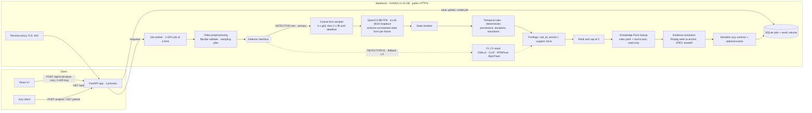

# Architecture: cashier-violation service (ADR-002)

Decision and evidence: `architecture-decision.md`. Work split and order: `implementation-plan.md`.
Tags: **[M]** measured · **[Rep]** teammate log · **[E]** estimate · **[H]** hypothesis.

## 1. Flow



The VLM never sees the rules, never produces text that reaches the user, and never chooses a citation. The verdict follows directly from the findings: `violation` iff the list is non-empty.

## 2. Component contracts

All contracts live in one module, `backend/contracts.py`. They are frozen at kickoff and changed only after notice to every work-package owner (AGENTS.md). Pydantic v2, abbreviated:

```python
# ---- preprocessing ----
class VideoInfo(BaseModel):
    sha256: str; duration_sec: float = Field(gt=0, le=180); width: int; height: int; fps: float

class SamplingPlan(BaseModel):
    coarse_t: list[float]          # 4 s grid over [0, duration], always includes the last second
    fill_t: list[float]            # 2 s midpoints, processed only while budget remains
    deadline_monotonic: float      # absolute; derived from upload time + 270 s

# ---- perception (VLM) ----
SafeDoor = Literal["open", "closed", "not_visible"]
Screen = Literal["unlocked", "lock_screen", "off_or_closed", "not_visible"]
class FrameState(BaseModel):       # fields = FEATURES.md v1/v2; the free-text "other" field is dropped here
    cashier_at_desk: bool; cashier_in_room: bool; people_cashier_side: int = Field(ge=0, le=5)
    clients_at_desk: int = Field(ge=0, le=5); person_at_door: bool; collector_present: bool
    desk_cash: bool; desk_bag: bool; desk_documents: bool; desk_personal_items: bool; desk_food_drink: bool
    phone_in_cashier_hand: bool; id_document_visible: bool; counting_machine_in_use: bool; detector_in_use: bool
    safe_door: SafeDoor; key_in_safe_lock: Literal["yes", "no", "not_visible"]; laptop_screen: Screen
    room_door: SafeDoor; cash_in_hands_of: Literal["nobody", "cashier", "client", "collector", "several"]
    cashier_action: CashierAction  # 16-value enum from the kit schema

class FrameObservation(BaseModel):
    t: float; ok: bool; state: FrameState | None; error: str | None; latency_s: float

class Coverage(BaseModel):
    step_s: float; planned: int; done: int; failed: int; deadline_hit: bool; mode: Literal["full", "coarse", "partial"]

class StateTimeline(BaseModel):
    video: VideoInfo; frames: list[FrameObservation]; coverage: Coverage

# ---- detection seam (both detectors implement it) ----
class Finding(BaseModel):
    rule_id: str                   # canonical id from knowledge/rules.yaml
    t_anchor: float                # reported timecode
    t_start: float; t_end: float   # supporting interval
    support_t: list[float]         # sampled times that satisfied the condition
    facts: dict[str, str | int | float | bool]   # template slots, e.g. away_s, object
    rank_score: float              # persistence-based; ranking frozen on dev

class DetectionResult(BaseModel):
    findings: list[Finding]; coverage: Coverage; warnings: list[str]

class Detector(Protocol):
    def detect(self, video: Path, info: VideoInfo, plan: SamplingPlan) -> DetectionResult: ...

# ---- knowledge pack ----
class NormRef(BaseModel):
    norm_id: str; act: str; punkt: str; quote: str; url: HttpUrl
    strength: Literal["direct", "indirect"]; human_verified: bool; verified_by: str | None; verified_at: date | None

class RuleEntry(BaseModel):
    rule_id: str; title_ru: str; title_en: str; mechanism: str
    states_used: list[str]; params: dict[str, float]
    description_template: str      # slots from Finding.facts plus {t}
    visibility_caveat: str         # what the video cannot establish
    norm_ids: list[str]            # first = primary citation
    enabled: bool

class GroundedFinding(BaseModel):
    finding: Finding; rule: RuleEntry; norms: list[NormRef]
    citation_status: Literal["verified", "needs_review"]

# ---- API (jury contract unchanged; extras optional) ----
class EvidenceFrame(BaseModel): timestamp_sec: float; image_base64: str   # JPEG only
class Violation(BaseModel):
    type: str; timecode_sec: float; description: str
    evidence_frames: list[EvidenceFrame] = Field(min_length=1, max_length=3)
    # optional extras, used by the UI:
    rule_id: str; source: str; source_url: str; strength: str; citation_status: str
class DoneJob(BaseModel):
    job_id: str; status: Literal["done"]; verdict: Literal["violation", "no_violation"]
    violations: list[Violation]; warnings: list[str] = []; coverage: Coverage | None = None
```

| Boundary | Producer → consumer | Contract | Rule |
|---|---|---|---|
| Preprocessing | worker → detector | `VideoInfo`, `SamplingPlan` | Rejects non-MOV, empty, > 180 s, unreadable streams with an explicit `failed` |
| Discovery | sampler + VLM client | `StateTimeline` | Covers the whole video. A schema-invalid answer is `ok=False`, retried once, then counted in `coverage.failed` |
| Verification and localization | temporal rules | `DetectionResult` | Pure function of the timeline and `RuleEntry.params`. No I/O, no labels |
| Classification | rules | `Finding.rule_id` | The rule *is* the mechanism class. No separate classifier |
| Rule grounding | knowledge loader | `GroundedFinding` | Unknown `rule_id` → startup error. Unverified norm → `needs_review`, shown as such |
| Evidence | evidence builder | `EvidenceFrame[1..3]` | Frames cut from the source video at `t_anchor` and the nearest `support_t`, not from 768 px samples |
| Job management | API ↔ worker | SQLite row: `processing`, `done` or `failed` | Every exception → `failed` with a message. Never a fabricated `no_violation` |
| Serialization | worker → API | `DoneJob` | Required jury fields unchanged; extras optional |

**Evaluation is separate from runtime.** `eval/` may read `data/`, organizer labels, `gt.json` and splits. `backend/` must not: a test checks that no backend module references `data/`, `open_labels`, `gt.json` or an `.xlsx` file. The Excel workbooks are build-time research inputs only.

## 3. Knowledge Pack (runtime, read-only)

```
knowledge/
  rules.yaml    # canonical rules: id, titles, mechanism, states_used, params, template, caveat, norm_ids, enabled
  norms.json    # only the norms referenced by rules: verbatim quote, act, punkt, adilet URL with #z anchor,
                # strength, human_verified, verified_by, verified_at
  README.md     # provenance: built from forte_brev_kit codex_verified.json (217 norms) + F1 codex.yaml templates
scripts/build_knowledge.py   # rebuild only; the runtime never reads the source files
```

- **Mapping is deterministic**: `rule_id → norm_ids`. There is no retrieval or embedding search at runtime. Add one only if a concrete need appears (none has).
- The questionnaire's free-text `other` field is dropped. It is not used for routing or display.
- **Three statements stay distinct in the output:**
  1. **observation**: the template filled with measured facts, e.g. "с 41 по 49 с кассир вне рабочего места; на столе видны купюры";
  2. **claim**: "признаки возможного нарушения: <rule title>";
  3. **citation**: act, punkt, quote and URL, with `citation_status`.
- Proposed canonical IDs reuse the F1 names, which already have templates in `codex.yaml`. Kit rule → canonical ID (WP3 confirms):
  - `leave_cash`→`L-NO-CASH-ON-LEAVE`, `leave_key`→`L-SAFE-LOCKED-ON-LEAVE`, `leave_laptop`→`L-PC-LOCKED`, `leave_docs`→`L-NO-DOCS-ON-LEAVE`
  - `safe_open`→`S-SAFE-CLOSED`, `dirty_desk`→`S-CLEAN-DESK-HANDOVER`, `merge_cash`→`S-NO-MERGE`
  - `outsider`→`A-OUTSIDER-ZONE`, `door_open`→`A-DOOR-LOCK`, `two_clients`→`A-SECOND-PERSON`
  - `client_left_count`→`C-COUNT-BEFORE-EXIT`, `no_id`→`C-ID-BEFORE-CASH`, `no_detector`→`C-DETECTOR-CHECK` (disabled, experimental)
  - `personal_items`→`W-NO-PERSONAL-ITEMS`, `food`→`W-NO-FOOD`, `phone`→`W-NO-CAMERA-PHONE`
  - `collector_quick`→`K-SEAL-CHECK`, `bag_to_safe_no_count`→`K-RECOUNT-BEFORE-SAFE`
- **Known citation conflicts to resolve by a human against adilet.zan.kz before 09:00:**
  - screen lock is `53-71-9` in the kit vs `48-71-9` in the R1 workbook; the F1 app marks it "repealed; successor to confirm";
  - each rule's kit `CODEX` list vs F1 `codex.yaml` `source`.

## 4. Scheduling, deadline and concurrency

- **One GPU job at a time** (FIFO worker thread). Inside a job, up to 8–16 frame requests are in flight, so vLLM batches them.
- Running jobs in parallel does not add GPU throughput on one L4. It only splits it.
- **Deadline per job** = upload time + 270 s. The 30 s margin covers evidence, serialization and client polling.
- **Coarse-first plan:**
  1. Run the 4 s grid first; the whole video gets covered early.
  2. Fill in the 2 s midpoints while the estimated remaining time allows. The estimate is the running mean of seconds per frame.
  3. At deadline − 15 s, stop issuing requests and run the rules on what completed. `coverage.mode` is then `partial`, with a warning in the UI and in `warnings`.
- **Measured basis for the steps** (saved states, `arch_rule_sweep.txt`):
  - 2 s gives the same result as 1 s (22–23/40, recall 19/21, any ±3 s 13–14/22);
  - 4 s alone is offset-sensitive (recall 16–19/21, any ±3 s 6–12/22). That is acceptable as a degraded mode, not as the default.
- Queue pressure is handled by the same mechanism: a job that waited in the queue starts with less budget and gets a coarser plan.
- Estimated for two simultaneous 145 s uploads: job 1 ≈ 186 s in full mode; job 2 starts with ≈ 84 s left and gets about 30 frames (≈ 5 s spacing). Three simultaneous long uploads cannot all finish within 300 s on one L4. This is a documented limitation.

## 5. Resource budget (`datathon2`, L4 23 GB, 4 vCPU, 15 GB RAM)

| Component | Model / runtime | GPU VRAM | CPU RAM | Disk | Latency | Confidence | Contention risk |
|---|---|---|---|---|---|---|---|
| Reverse proxy + FastAPI + SQLite | uvicorn, 1 process | 0 | ~0.3 GB | small | ms | high | none |
| Preprocessing | ffprobe, ffmpeg (CPU; NVDEC available) | 0 | <0.5 GB | uploads ≤ 64 MiB, deleted after the job | 3–8 s per 145 s clip [E] | medium | 4 vCPU shared with the vLLM frontend |
| Perception | Qwen3.5-9B FP8, vLLM, `max_model_len` 8–16k, `max_num_seqs` 16 | 11.05 GiB weights + non-torch [Rep]; 0.55 activation [Rep]; KV 2.7 GiB at util 0.65 [Rep] → **set util 0.80 ≈ 17.6 GiB** | 6–8 GB while loading [Rep: 6.4 GiB free RAM sufficed]; ~3 GB steady [E] | 18 GiB BF16 checkpoint, quantized online | **2.41 s per frame effective** at 8 in flight on a *shared* GPU in eager mode [Rep]; expected better on a dedicated GPU with CUDA graphs and prefix cache [E] | medium | Owns the GPU. Nothing else should load on it in primary mode |
| Temporal rules | Python | 0 | negligible | — | <0.1 s [M] | high | none |
| Knowledge Pack | YAML/JSON | 0 | <10 MB | <1 MB | <10 ms | high | none |
| Evidence | ffmpeg seek, Pillow JPEG | 0 | <0.2 GB | in the result JSON (~1–1.5 MB) | 1–3 s [E] | medium | CPU |
| Fallback L2 | Qwen3-VL-4B (vLLM or HF) | ~10 GB [M, HF bf16] | ~4 GB | 8.3 GB, already on disk | not measured with the form | low | Replaces the 9B; never loaded alongside it |
| Fallback L3 | F1 stack | 1.65 GiB peak [Rep] | ~3 GB [E] | 1.4 GB weights | median 51 s; **294.6 s on a 72 s clip at 5 fps** [Rep→M] | medium | Loaded only when `DETECTOR=f1` |

Coexistence: 9B at util 0.80 (≈17.6 GiB) + F1 (1.65 GiB) + CUDA contexts (~0.5 GiB each) ≈ 20.3 GiB. That technically fits in 22.6 GiB free, but we do not plan on it: **one detector is active per deployment**, and switching means a restart.

## 6. End-to-end latency, 145 s MOV, warm service

| Stage | Time | Basis |
|---|---|---|
| Upload ~29 MB (counts on the jury clock) | 2–10 s | network [E] |
| ffprobe, validation, sampling 73 frames at 768 px | 4–9 s | [E] |
| VLM coarse pass, 37 frames | ≈ 89 s | 37 × 2.41 s [Rep-based E] |
| VLM fill pass, 36 frames | ≈ 87 s | 36 × 2.41 s [E] |
| Rules, ranking, Knowledge Pack | < 0.2 s | [M] |
| Evidence (≤ 3 × 3 JPEG) and serialization | 1–4 s | [E] |
| **Total** | **≈ 185–200 s → headroom ≈ 100–115 s** | must be measured on `datathon2` (WP2 gate G1) |
| Cold start (not on the jury clock if the service is warm) | vLLM init 225 s [Rep, eager] + weight load; app ~10 s | readiness gate; warm-up request at boot |

Trade-off levers, cheapest first. All are configuration, and each is re-checked on saved states or dev before use:
1. prefix-cache the fixed form prompt (text first, image last) [E: prefill is ≈ 90 % of tokens];
2. turn off `enforce_eager` (CUDA graphs);
3. compact JSON keys in the form;
4. max side 640;
5. 4 s coarse only;
6. 4B model.

**Not used:** concurrent jobs (no throughput gain), whole-video VLM (falsified), and 1 fps (no gain over 2 s).

## 7. Failure and fallback behaviour

| Failure | Detection | Behaviour |
|---|---|---|
| VLM cannot load | `/readyz` false; vLLM `/v1/models` unreachable at boot | Jobs stay queued up to 60 s, then `failed: "model unavailable"`. Operator switches to L2 (4B) or L3 (`DETECTOR=f1`) and restarts. No fake results |
| VRAM exhausted | vLLM OOM at start, or request errors | Start with a fixed `gpu_memory_utilization` and nothing else on the GPU. At runtime a failed frame is `ok=False` and counted. Over 30 % failed frames → job `failed` with the reason |
| Inference exceeds the deadline | per-job deadline in the sampler | Stop at deadline − 15 s, rules on partial coverage, `coverage.mode="partial"` plus a warning. The job still finishes in < 300 s |
| Proposer recall inadequate | n/a: no proposer; the whole video is sampled | Residual risk: events shorter than the sampling gap (2 s full, 4 s coarse). Documented |
| VLM hallucinates small objects (cash, keys) | persistence rule: state must hold `min_samples` in a row; template states only the observed fields | Known weak fields: `key_in_safe_lock` 0/2 and `desk_cash` 1/3 on gold with v1 prompts. Optional Phase 4 crop re-ask, gated by a dev → lockbox gain |
| Required rule's citation unverified | `human_verified=false` in `norms.json` | Shown as "источник требует проверки". The violation is still reported (recall first), but its citation is never presented as confirmed |
| Camera angle changes | none needed: no calibration or zones | The form asks semantic questions ("cashier at desk"). Measured only on 3 layouts of one camera style. WP4 films other-angle clips |
| Invalid upload (not MOV, empty, corrupt, > 180 s, > 64 MiB) | API checks plus ffprobe | HTTP 415/413/422 at upload, or job `failed` with a message |
| Public API unavailable | external uptime probe every 5 min (WP1), restart policy on both services | Systemd/compose `restart: unless-stopped`. Results persist in SQLite across restarts; pending jobs re-enqueue on start (existing shell behaviour) |

## 8. Deployment, locality and data handling

**Host and serving:**
- Host: `datathon2`.
- `vllm serve` runs in its own venv as a systemd unit, bound to `127.0.0.1:8010`, with `HF_HUB_OFFLINE=1`, `VLLM_NO_USAGE_STATS=1`, `DO_NOT_TRACK=1`, `--limit-mm-per-prompt '{"image":1,"video":0}'`.
- The app runs as the existing compose stack, with host networking or loopback access to vLLM.
- The reverse proxy terminates TLS.

**Public URL:** to be verified first (WP1). Options, in order:
1. Brev's port exposure;
2. the VM's public IP with Caddy and an IP-based hostname;
3. a tunnel, as transport only. Confirm with the organizers if in doubt.

**Endpoints:**
- `/api/v1/analyze` and `/api/v1/jobs/{id}` (X-API-Key, constant-time compare);
- `/healthz` and `/readyz` (no data in the body);
- UI at `/`.

The API key lives in `.env` on the VM, mode 600. It is never in the frontend bundle; the UI asks for it.

**Data handling:**
- Uploads and sampled frames are deleted when the job ends.
- Result JSON (with evidence) is kept 24 h, then purged.
- Everything is deleted after the hackathon (FAQ 6).
- Video, frames and descriptions never leave the VM. The only network use is weight download before deployment.

**Licences** (check the model cards before submission):
- Qwen3.5-9B: Apache-2.0 [Rep];
- vLLM, FastAPI, React: Apache/MIT;
- F1 stack models: Apache-2.0/MIT [Rep];
- ffmpeg runs as a separate process (system package).
