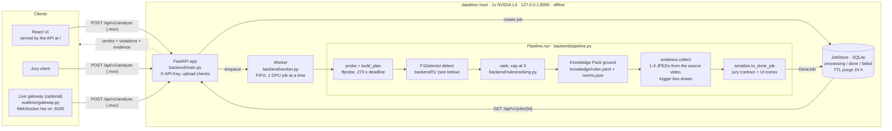
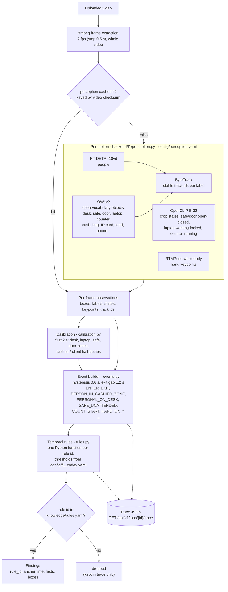

# Architecture summary

## Current deployment and evidence (A21)

The complete checker, local Qwen3-VL-4B helper and realtime gateway run on one
datathon2 VM (8003/8103). The existing public A20 endpoint on datathon is separate.
The two-VM 20+20 split was temporary evaluation only.

Current API: 42/42 jobs complete; **30/40** unique verdicts, **0/19** clean false alarms,
**10/21** misses. Findings: 9 compatible with human prose, 0 contradicted, 3 unknown.
The higher A20 score included two contradicted explanations; no detection gain is claimed.
See [A21 results](../attempts/A21-deadline/RESULTS.md) and
[current startup](../realtime/README.md#current-one-vm-review-service).

After the initial event build, `backend/f1/visual_checks.py` selects bounded local checks.
The enabled `safe` family refines exact known samples, rebuilds events and passes provenance
into rule consumers. It does not create cash/ID detections, room exits, ownership or legal
conclusions. Door answers remain diagnostic. This is `DETECTOR=f1` with a VLM helper,
not the alternative `DETECTOR=vlm` pipeline. Generic settings remain opt-in; the current
launcher defaults to on at the user's request.

Evidence guards distinguish room exit from workstation movement, require interval evidence
for ID non-presentation, expire ownership across gaps and retain clip boundaries. A doorway-
hand departure can corroborate a cashier exit when hips miss the calibrated zone; an
ambiguous overlapping continuation blocks that added path.

The short version for task.md §8 ("краткое описание архитектуры, выбранного
подхода и используемых моделей"). It describes the detector that is actually
deployed: the F1 computer-vision stack (`DETECTOR=f1`, the default in
`backend/config.py`). The earlier VLM-first version of this page is kept in
`archive/docs-vlm-era/ARCHITECTURE_SUMMARY.md`; the design records behind it
are `archive/research1/architecture-decision.md` (ADR-002) and
`archive/research1/architecture.md`.

## Approach

No model decides the verdict. Pretrained detectors only report what is in
each frame (people, objects, door/safe/screen states, hand keypoints). A
deterministic event builder turns those observations into a timeline of
events (cashier left the desk, cash on desk, someone entered, door closed,
...), and plain-Python temporal rules turn the event timeline into findings.
A read-only Knowledge Pack attaches each finding's normative citation. The
verdict is `violation` if and only if at least one finding survives.

### System flow

The API accepts the upload, writes a `processing` row and returns a job id
at once (HTTP 202). The worker takes one job at a time, so the GPU is never
shared, and runs `Pipeline.run`. The finished `DoneJob` (or a `FailedJob`
with the error) goes back into SQLite, where clients poll it with
`GET /api/v1/jobs/{id}`. The uploaded video is deleted when the job ends.

### Inside the F1 detector

## What the rules rely on

The event builder and rules were reworked on 2026-10-18 (attempt A20,
`attempts/A20-night-orchestration/`). Each behaviour below is a mechanism with a unit test, not a
threshold fitted to one clip:

| Area | Behaviour |
| --- | --- |
| Scene scale | Distances (hand reach, laptop reach, glass and service margins) are multiples of the calibrated desk length, not fixed fractions of the image, so a camera nearer or farther gives the same events |
| Workstation presence | The cashier counts as at the workstation while a confident hand is inside the laptop or money-counter box, even when the hips are farther away |
| Leaving | An item counts as left behind only if it is seen in at least 2 frames of each short evidence window and the cashier stays away through the confirmation delay. A cash bag counts for `L-NO-CASH-ON-LEAVE` |
| Entries | Someone already in the doorway in the first frame has not entered; the door rule needs an observed entry |
| Client sessions | A client whose track is lost and reappears in place within the exit gap is the same client; a client exit needs visible movement away from the desk; two clients with hands on the desk at once, held, is a second client; the counter still running when the client leaves is counting without the client |
| Personal items | Brief detection gaps don't split one item; boxes that match the laptop or the money counter are equipment, not personal items; a small coat box above the person's hip line is worn clothing |
| Cash collection | `K-SEAL-CHECK` fires when a visitor with an observed entry delivers a bag that appears on the desk and leaves quickly, without staying for the check |
| Ranking | Among equal findings, the one with a confirmed exit ranks first, so the top timecode is the moment the cashier is really gone |

## Pipeline stages

| Stage | Input | Output | Why it is there |
| --- | --- | --- | --- |
| Probe + plan (`backend/media.py`, `backend/plan.py`) | uploaded file | duration, sampling plan, monotonic deadline | Rejects broken videos early and fixes a 270 s budget, 30 s inside the jury's 300 s limit |
| Frame extraction (`backend/f1/detector.py`) | video | JPEG frames at 2 fps | Uniform coverage of the whole clip; reported as `coverage.mode="full", step_s=0.5` |
| Perception (`backend/f1/perception.py`) | frames | per-frame detections, states, keypoints, track ids | Models only describe the scene; none of them sees the rules or decides anything |
| Calibration (`backend/f1/calibration.py`) | first 2 s of observations | `Scene`: zones for desk, laptop, safe, door, and cashier / client sides | Turns pixel boxes into places, so "a person is behind the desk" becomes a geometric check |
| Event builder (`backend/f1/events.py`) | observations + scene | time-ordered `EventLog` | Hysteresis and exit gaps remove single-frame flicker before any rule runs |
| Rules (`backend/f1/rules.py`) | event log, thresholds from `config/f1_codex.yaml` | findings with an anchor time | Each rule is a small, testable Python function (for example `l_no_cash_on_leave`, `a_door_lock`, `w_no_food`); only ids present in the Knowledge Pack survive |
| Rank (`backend/rules/ranking.py`) | findings | at most 3 findings | Keeps the answer short and puts the most important ones first |
| Knowledge Pack (`backend/knowledge.py`) | rule ids | findings with norm citations and descriptions | Deterministic `rule_id -> norm_ids` lookup; no model writes legal text |
| Evidence (`backend/evidence.py`) | original video + anchor times | 1-3 base64 JPEGs with the triggering box drawn | Shows the jury the exact moment; cut from the source video, not from the sampled frames |
| Serialize (`backend/serialize.py`) | grounded findings, coverage, frames | `DoneJob` in the jury contract | `verdict = violation` if and only if at least one finding is left |

## Components

| Component | Role |
| --- | --- |
| FastAPI app (`backend/main.py`) | Auth (`X-API-Key`), upload validation, job store, `/healthz` and `/readyz` (weights present and matching `models.lock.json`) |
| Worker (`backend/worker.py`) | One job at a time from a FIFO queue; other uploads wait |
| Orchestration (`backend/pipeline.py`) | probe, plan, detect, rank, ground, evidence, serialize |
| Detector (`backend/f1/`) | Perception, calibration, events and rules described above |
| Rule thresholds (`config/f1_codex.yaml`) | `rules` generated from `knowledge/rulebook.yaml` by `scripts/build_knowledge.py` |
| Knowledge Pack (`backend/knowledge.py`, `knowledge/`) | Rule lifecycle and deterministic `rule_id -> norm_ids` lookup; citations carry KZ document metadata and `verified`/`pending`/`invalid` status. F1 startup checks codex, evaluator IDs, and enabled rules. Built by `scripts/build_knowledge.py` |
| Evidence (`backend/evidence.py`) | Frames from the original video at the finding's anchor time, never from the detector's sampled frames |
| Serializer (`backend/serialize.py`) | Maps `GroundedFinding` to the jury's `Violation` shape |
| Live gateway (`realtime/`) | Optional: feeds a folder of videos through the API one by one and streams verdicts over a WebSocket |

## Locality

Every model runs on the selected local GPU host (current A21: datathon2, one NVIDIA L4) from
F1 weights downloaded ahead of time (`scripts/download_weights.py`, pinned in
`models.lock.json`), plus the separately provided Qwen checkpoint described in
`docs/MODELS.md`. Hugging Face offline mode is forced in
`backend/f1/perception.py`, so processing needs no internet access and no
cloud AI API is called (task.md §7, FAQ 21). The service binds to
`127.0.0.1:8000`. Uploaded videos and sampled frames are deleted when a job
ends; result JSON is kept for `RESULTS_TTL_HOURS` (24 h by default) and then
purged.

## Deadline and coverage

- Each job has a budget of 270 s (`JOB_BUDGET_S`), a 30 s margin inside the
  jury's 300 s limit.
- F1 samples the whole video uniformly at 2 fps. Coverage is reported as
  `mode="full", step_s=0.5`; if the budget runs out before perception
  finishes, `coverage.deadline_hit` is `true`.
- Perception results are cached per video checksum
  (`Settings.reuse_perception`, on by default), so re-running the same
  video can skip F1 inference. Visual answers have a separate identity-keyed cache.

## Alternative detector (not deployed)

`DETECTOR=vlm` switches perception to a vision-language model (Qwen3.5-9B
FP8 on vLLM, `backend/vlm/`, `deploy/vllm/`) that fills a per-frame state
form, followed by the timeline rules in `backend/rules/timeline.py`. Its
code and tests are kept, but it is not what runs on `datathon`; see
`archive/docs-vlm-era/` for that design.

## Measured results

Offline replay on the cached perception of the 40 unique open videos, scored against the
organizer labels (`attempts/A20-night-orchestration/`):

| Version | Correct /40 | Clean videos flagged /19 | Violations missed /21 |
| --- | --- | --- | --- |
| A01, the F1 stack before it was ported into this service | 20 | 13 | 7 |
| A17, deployed on `datathon` before A20 | 25 | 5 | 10 |
| A20, historical baseline | 32 | 0 | 8 |
| **A21, current real API with local helper** | **30** | **0** | **10** |

- **Historical A20 timecodes:** 13 caught violations; mean distance to the organizer second 1.54 s; within
  ±1 / ±3 / ±5 s: 7 / 11 / 13.
- **Historical A20 robustness probes** (`scripts/replay_f1.py run --zoom/--mirror/--drop`, the clips replayed
  as another camera distance, a mirrored camera or a weaker detector): zoom 0.7-1.3 and mirror
  give exactly 32/0/8; losing 20% of object detections gives 31-32 / 0 / 8-9.
- All public clips influenced development; these are not held-out results. A21's current
  ten misses and unknown legal/timing support are listed in `docs/LIMITATIONS.md`.
- Current enabled API latency: median 2.0675 s with 41 perception cache hits and 476 answer
  hits; a forced-cold X20 took 50.669 s. The 158.6 s longest-clip cold measurement had the
  VLM off. Do not present cached or disabled-helper measurements as current cold latency.
